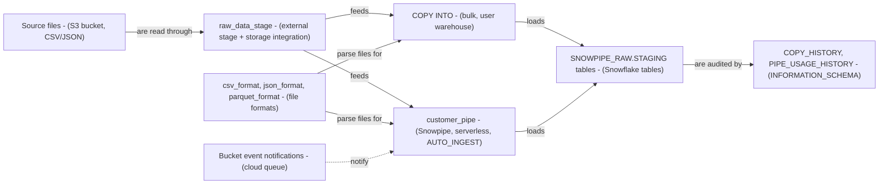

# Snowflake Snowpipe and Data Loading - Architecture and design rationale

*Last updated: 2026-11-07 · commit 2edefc322*

## 1. Purpose and scope

A learning tutorial on loading files from cloud storage into Snowflake: stages, file formats, bulk `COPY INTO`, a
Snowpipe with auto-ingest, and monitoring. It is for the author's own development and for readers learning the topic. It
is not a production ingestion design, and it cannot be run unchanged: the stage points at a placeholder bucket and a
placeholder storage integration. The repository does not say whether it was run against a trial, sandbox or other
account; that is not documented.

## 2. How this project was built

This project was built with Claude Code (Anthropic's AI coding assistant) in a complementary role. Elliott Fairhall is
the author and owner: the project is debugged, tested and used by him for learning and development, and the design
decisions below are explained so that they can be understood, questioned and learned from. The scripts are tutorial
material and the repository holds no record of an end-to-end run, so this document does not claim one.

## 3. Architecture at a glance

Both loading paths share one stage and the same file formats. Only the trigger and the compute differ: a person with a
warehouse for `COPY INTO`, and a bucket event with Snowflake-managed compute for the pipe.

## 4. Learning path

| Step | File                            | What it teaches                                                                                                                    | Why here                                                    |
| ---- | ------------------------------- | ---------------------------------------------------------------------------------------------------------------------------------- | ----------------------------------------------------------- |
| 0    | `00_setup_environment.sql`      | `SNOWPIPE_RAW.STAGING`, `SNOWPIPE_RAW.PIPES`, and target tables `CUSTOMERS`, `ORDERS`, `EVENTS` (the last with a `VARIANT` column) | Targets must exist before anything loads                    |
| 1    | `01_stage_setup.sql`            | External stage with a storage integration; `LIST`                                                                                  | Both load methods read from a stage                         |
| 2    | `02_file_format_definition.sql` | CSV, JSON and Parquet file formats                                                                                                 | Reused by every later `COPY` and the pipe                   |
| 3    | `03_bulk_loading_copy.sql`      | Basic `COPY`, `COPY` with a `$n` transformation, `PATTERN` filtering (all commented out)                                           | The manual path is the baseline Snowpipe automates          |
| 4    | `04_snowpipe_definition.sql`    | `CREATE PIPE ... AUTO_INGEST = TRUE AS COPY ...`; `SHOW PIPES`                                                                     | A pipe wraps the same `COPY` statement, so it follows it    |
| 5    | `05_pipe_management.sql`        | `SYSTEM$PIPE_STATUS`, `ALTER PIPE ... REFRESH` (commented out)                                                                     | Operating a pipe once it exists                             |
| 6    | `06_load_monitoring.sql`        | `COPY_HISTORY`, `PIPE_USAGE_HISTORY`, filtering `LOAD_FAILED`                                                                      | Verification comes last, once there is something to inspect |

The sequence is documented in the tutorial's table of contents; the "Why here" reasoning is inferred. The key teaching
move is that the pipe's body is the bulk `COPY` statement unchanged.

## 5. Design rationale

### Teach bulk `COPY INTO` before Snowpipe

- **Why:** a pipe is a `COPY INTO` definition plus a trigger. Once the reader understands formats, transformation and
  patterns in the bulk form, the pipe needs only one new idea, the event trigger.
- **Gave up:** a reader wanting only continuous ingestion has to read past the bulk material.
- **Alternative not taken:** start with Snowpipe because it is the more modern pattern.
- **Evidence:** documented as the comparison table (user warehouse vs serverless) in the tutorial; the ordering reason
  is inferred.

### An external stage with a storage integration, with placeholder values

- **Why:** auto-ingest depends on cloud event notifications, which an internal stage cannot provide in the same way
  `TODO: verify`, so the tutorial uses an external stage. A storage integration keeps cloud credentials out of the SQL.
- **Gave up:** the exercise cannot be run as it stands. `s3://my-bucket/raw/` and `my_s3_integration` are placeholders,
  and the tutorial does not walk through creating the integration, the IAM role or the bucket notification. The README
  mentions a `data/` folder of sample schemas; none is tracked.
- **Alternative not taken:** an internal stage with a few bundled sample files, which would run anywhere but could not
  demonstrate auto-ingest.
- **Evidence:** documented in the tutorial text ("you must configure your cloud storage to send notifications");
  placeholders visible in `01_stage_setup.sql`.

### Most bulk and management statements are commented out

- **Why:** `03` and `05` are reference snippets; running them blind would fail or load nothing without real files.
- **Gave up:** the only live statements are stage, file formats, the pipe, `SHOW PIPES` and the monitoring queries.
- **Alternative not taken:** a sample-file upload step with `PUT` so that `COPY` can run for real.
- **Evidence:** inferred from the code.

### Pipe and `COPY` reference unqualified stage and format names

- **Why (inferred):** shorter snippets.
- **Gave up:** `raw_data_stage` and `csv_format` are created without a database or schema, so they live wherever the
  session happens to be. The pipe sits in `snowpipe_raw.pipes` and refers to them unqualified, so the pipe definition
  only resolves if the session context is the one that created them.
- **Alternative not taken:** qualified names such as `snowpipe_raw.staging.raw_data_stage`.
- **Evidence:** inferred from the code.

### `ON_ERROR = 'CONTINUE'` in the basic example

- **Why:** shows that a load can tolerate bad rows rather than abort.
- **Gave up:** rows can be skipped silently, which is why script 06 then teaches `COPY_HISTORY` and the `LOAD_FAILED`
  filter. The tutorial does not discuss `VALIDATION_MODE` or `ABORT_STATEMENT`.
- **Alternative not taken:** the default abort behaviour, which is safer for a first load.
- **Evidence:** inferred from the code.

### Cost and operational safety

- A running auto-ingest pipe has no schedule to leave on, but it will keep loading any file that lands in the bucket
  prefix, and it uses Snowflake-managed compute. The tutorial states that this serverless model charges only for the
  processing used; the pricing basis is not verified here. `TODO: verify`
- The tutorial gives no cleanup: the pipe, stage, formats and tables remain after the exercise.
- `CREATE OR REPLACE PIPE` is used; what that does to the pipe's load history and notification channel has not been
  checked. `TODO: verify`
- The tutorial states that `COPY INTO` will not reload a file within a 64-day window. That figure is the tutorial's
  claim, not checked here. `TODO: verify`

## 6. Quality and testing

No tests, CI or sample data are in the folder. The monitoring script is the only built-in check, and it reads
Snowflake's load history rather than asserting expected row counts.

## 7. Constraints, limitations and known gaps

- Not runnable without a real bucket, storage integration and event notification setup; none is documented.
- The setup script now begins with a warning that it drops and recreates these tables (a reset step), and should only be
  run in a scratch account or clean database. Each tutorial now has its own database names (prefix `SNOWPIPE_` here), so
  it no longer touches another tutorial's tables (changed 2026-11-07).
- `00_setup_environment.sql` uses `CREATE OR REPLACE TABLE` on `SNOWPIPE_RAW.STAGING.CUSTOMERS`, `ORDERS` and `EVENTS`.
  The Stored Procedures and UDFs and Streams and Tasks tutorials create a `STAGING.CUSTOMERS` table with different
  columns in their own prefixed databases (`SPROC_RAW`, `STREAMS_RAW`), so they no longer overwrite each other (changed
  2026-11-07).
- `01_stage_setup.sql` and `02_file_format_definition.sql` use `CREATE OR REPLACE` on a stage and file formats;
  replacing a stage or format that a live pipe depends on is risky. `TODO: verify` the effect.
- `parquet_format` is defined but never used; the `PATTERN` example hardcodes `2026-03`.
- The tutorial describes `SYSTEM$PIPE_STATUS` as a way to "trigger Snowpipe manually"; that function reports status, and
  `ALTER PIPE ... REFRESH` is the statement that queues files.
- No `USE DATABASE` or `USE SCHEMA` is shown, so `COPY_HISTORY(TABLE_NAME => 'CUSTOMERS')` depends on session context.

## 8. Running and extending

Setup and usage are in the [README](../README.md) and the [tutorial](../Tutorial/SNOWPIPE_TUTORIAL.md). To extend
safely: qualify every object name, add a sample-file step so the bulk path can run without cloud setup, and add a
cleanup script that drops the pipe first.

## 9. Rationale (confirmed by the owner)

Confirmed by Elliott Fairhall on 2026-11-07. This reasoning was first reconstructed from the code and commit history;
the owner has since agreed it is correct, so it is now the stated rationale rather than an inference.

- Bulk loading is taught before Snowpipe so the pipe reads as "the same `COPY` plus a trigger".
- An external S3 stage is used because auto-ingest needs cloud event notifications, not because internal stages were
  ruled out on other grounds.
- Placeholder bucket and integration names were left in deliberately because real ones would be account-specific.
- Statements in scripts 03 and 05 are commented out because they need real files and an existing pipe.
- Three target tables (`CUSTOMERS`, `ORDERS`, `EVENTS`) were chosen to match the three examples: plain CSV, a
  transformed CSV and JSON into a `VARIANT`.
